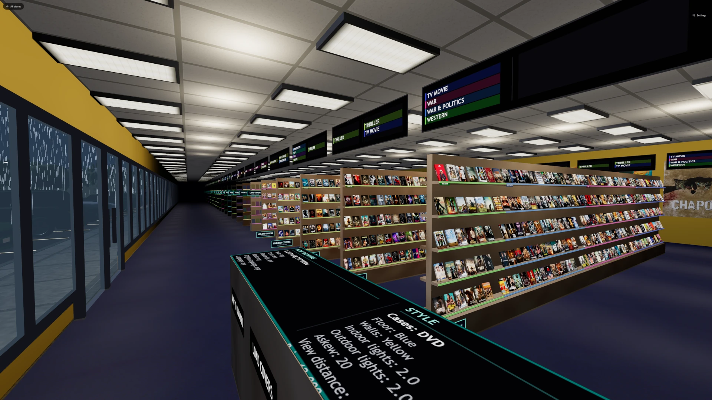

<!-- TODO: Validate -->
# Stream Channeler 3D Store

The walkable 3D video store from [Stream Channeler](https://streamchanneler.com/). Titles sit on shelves as cases that you can pick up, spin around, and take to the counter.



It's built with three.js, React, TanStack Query, Tailwind CSS, Lucide, TypeScript, Vite, Biome, and Bun.

## Why Open Source

The 3D store started as a small side project by one of Stream Channeler's developers. The team enjoyed playing with it so much that we added it to the main Stream Channeler website as an easter egg. It eventually became popular enough to earn a spot on the front page.

**But there is one small problem:** no one on the team has professional experience developing 3D environments. We have spent a fair amount of time optimizing the store so that it runs reasonably well, but there are surely many improvements we aren't aware of. So we open sourced this part of Stream Channeler so the community can help make the store better.

We are open to pretty much any additions/improvements you are willing to contribute even if it's something as extreme as completely changing the 3D engine we use or as small as fixing a typo.

## Run It

You need [Bun](https://bun.sh).

```bash
bun install
bun dev
```

To make open source development easier, the store can generate its own test data. Control it with these URL query parameters:

| Parameter | Default | Meaning |
| --- | --- | --- |
| `titles` | `2000` | How many titles the store stocks. |
| `seed` | `1` | Which titles are generated. The same seed always gives the same store. |
| `delay` | `200` | How many milliseconds each fake download takes. |

For example: `http://localhost:5173/?titles=20000&seed=7&delay=0`

Trailers play from YouTube, so they need an internet connection.

## Contributing

Contributions must be made under the [Contributor License Agreement](CLA.md), which assigns ownership of every contribution to Stream Channeler. To accept it, add the sentence from the agreement's **How to accept** section to the description of your first pull request.

## License

GNU Affero General Public License v3. See [LICENSE](LICENSE).
